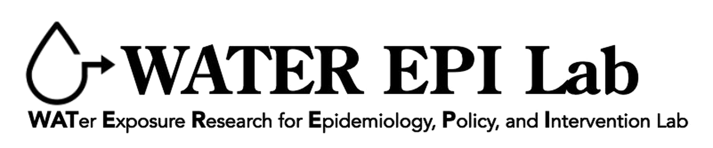

::: {.hero}

Justice-oriented research on US drinking water epidemiology and exposure assessment, metal exposures, chronic disease, and maternal and infant health.

:::

<figure class="hero-photo">

</figure>

::: {.prose style="margin-top:72px"}

Welcome

## Who we are {style="margin-top:0"}

Our lab is based in the [Department of Epidemiology](https://geiselmed.dartmouth.edu/epidemiology/) in the [Geisel School of Medicine at Dartmouth College](https://geiselmed.dartmouth.edu/). Our team conducts justice-oriented research on US drinking water epidemiology and exposure assessment, metal exposures, chronic disease, and maternal and infant health, leveraging collaborations with several large NIH-funded cohorts.

Recent work by our group includes epidemiologic analyses of public water contaminants and infant, maternal, and chronic adverse outcomes; methodological advances for public water exposure assessment; evaluations of federal drinking water policies and regulatory changes; and analyses of injustices in public drinking water contaminants.

Our long-term scientific goal is to reduce disparities in environmental exposures and adverse health outcomes, and improve health for all. By advancing public water exposure assessment, epidemiology, and policy/intervention work across the US, we aim to advance environmental justice, improve health equity, and directly inform regulations and other exposure-reduction interventions.
:::

::: {.pillars}
::: {.pillar}
### Exposure assessment
Methodological advances for public water exposure assessment.
:::
::: {.pillar}
### Epidemiology
Public water contaminants and infant, maternal, and chronic adverse outcomes.
:::
::: {.pillar}
### Policy & intervention
Evaluations of federal drinking water policies and regulatory changes.
:::
:::

<a class="btn-water" href="research.html">Our research</a>&nbsp; <a class="btn-water btn-ghost" href="https://zenodo.org/records/20443826">WATER EPI Lab Drinking Water Repository</a>

::: {.band .band-ink style="margin-top:88px;margin-bottom:-96px"}

<a href="https://www.publichealth.columbia.edu/about/mission-history/public-health-oath#:~:text=Health%20is%20a%20human%20right.">“Health is a human right. The public health community exists to safeguard that right.”</a>The Public Health Oath

:::
