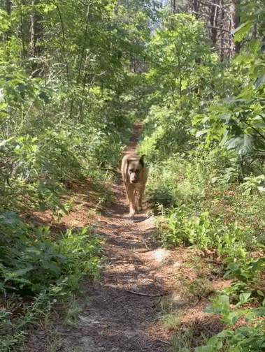

::: {.page-head}

About Annie

# Personal
:::

::: {.prose}

I'm originally from Natrona Heights, PA and currently live in New York City with my partner and my dog Roo. I enjoy hiking, urban and gravel cycling, the New York City public park system, and trail running — including my [favorite hometown trail system](https://rachelcarsontrails.org/).

<b>While you're here...</b> a few important links worth sharing:

- LGBTQ+ inclusion and visibility in STEM: [500 Queer Scientists](https://www.500queerscientists.com/)
- Principles of environmental justice: [Proceedings of the First National People of Color Environmental Leadership Summit](https://www.ejnet.org/ej/principles.html)
- MMIW — Missing and Murdered Indigenous Women: [Coalition to Stop Violence Against Native Women](https://www.csvanw.org/mmiw/)

<figure style="margin-top:28px"></figure>
:::

